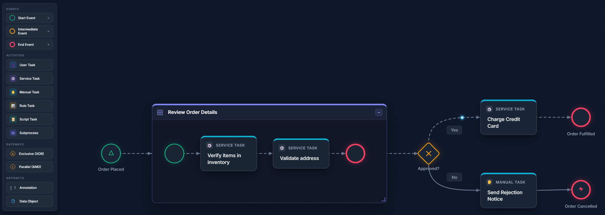
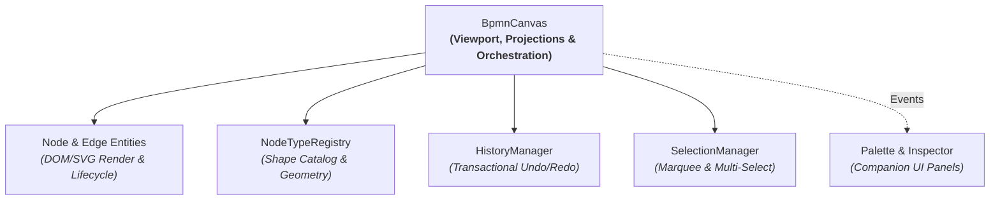

# BPMN Canvas

[](https://github.com/dphseven/bpmn-canvas/actions/workflows/ci.yml)
[](LICENSE)
[](https://www.npmjs.com/package/bpmn-canvas)
[](https://github.com/dphseven/bpmn-canvas/actions)
[](https://github.com/dphseven/bpmn-canvas)
[](package.json)

> A lightweight, zero-dependency workflow canvas and diagram modeler inspired by BPMN 2.0, built with native DOM + SVG architecture.



## Key Features

- **Zero-Dependency Native DOM + SVG Architecture**  
  Built entirely on standard browser APIs with zero runtime dependencies. Nodes render as native HTML elements for crisp typography and instant CSS styling, while connectors render as scalable SVG vector paths with high-DPI clarity

- **BPMN-Inspired Semantics Without the XML Bloat**  
  Model familiar BPMN concepts—activities, tasks, gateways, boundary event docking, and expandable subprocesses—without wrestling with rigid 5,000-line XML schemas. Diagrams serialize cleanly to and from predictable, human-readable JSON that stores directly in PostgreSQL JSONB, MongoDB, or REST APIs

- **Modular & Headless-Friendly by Design**  
  Architected on Single Responsibility Principles with decoupled subsystems (`BpmnCanvas`, `NodeTypeRegistry`, `Palette`, `Inspector`, `HistoryManager`, and `SelectionManager`). Embed the complete out-of-the-box studio, or mount just the canvas engine and control it from your own custom React, Vue, or Angular panels

- **Design System First (CSS Variable Theming)**  
  Every visual element is styled via standard CSS custom properties (`--bg-canvas`, `--border-focus`, `--accent-primary`, etc.). Seamlessly switch between dark mode, light mode, or custom enterprise palettes with zero canvas re-rendering

- **Reactive Event Bus & Transactional Commands**  
  Comprehensive, typed-like event catalog (`canvas.on()`, `once()`, `off()`) for fine-grained workflow telemetry. Full programmatic manipulation API (`updateNode`, `updateEdge`, `splitEdgeWithNode`) with atomic batching (`canvas.batch()`) to bundle compound operations into single undo/redo steps

- **Production-Grade Interaction Engine**  
  Includes smart Bezier and orthogonal Manhattan connector routing, boundary event snapping, automatic downstream node displacement on subprocess expansion, multi-node marquee selection, and animated token simulation for previewing execution paths

## Installation

```bash
npm install bpmn-canvas
# or
pnpm add bpmn-canvas
# or
yarn add bpmn-canvas
```

Include the companion stylesheets in your application entry point:

```javascript
import 'bpmn-canvas/styles/ui.css';
import 'bpmn-canvas/styles/canvas.css';
import 'bpmn-canvas/styles/nodes.css';
```

---

## Quick Start

### 1. HTML Container

Provide a styled container element where the canvas can mount:

```html
<div id="canvas-container" style="width: 100vw; height: 100vh;"></div>
```

### 2. Instantiate and Build a Workflow

```javascript
import { BpmnCanvas } from 'bpmn-canvas';

// Mount canvas to the DOM container
const container = document.getElementById('canvas-container');
const canvas = new BpmnCanvas(container, {
  snapToGrid: true,
  gridSize: 24,   
  defaultRouting: 'bezier' // or 'orthogonal'
});

// Add BPMN-inspired workflow nodes
const start = canvas.addNode({
  type: 'start-event',
  x: 100,
  y: 150,
  label: 'Order Placed'
});

const task = canvas.addNode({
  type: 'user-task',
  x: 260,
  y: 130,
  label: 'Review Order'
});

const end = canvas.addNode({
  type: 'end-event',
  x: 480,
  y: 150,
  label: 'Order Fulfilled'
});

// Connect with sequence flows
canvas.addEdge({ sourceId: start.id, targetId: task.id });
canvas.addEdge({ sourceId: task.id, targetId: end.id });
```

## Framework Integration

Because `bpmn-canvas` mounts directly onto any standard DOM element, it drops seamlessly into modern component lifecycles:

### React

```jsx
import { useEffect, useRef } from 'react';
import { BpmnCanvas } from 'bpmn-canvas';
import 'bpmn-canvas/styles/canvas.css';
import 'bpmn-canvas/styles/nodes.css';

export function WorkflowCanvas() {
  const containerRef = useRef(null);
  const canvasRef = useRef(null);

  useEffect(() => {
    if (containerRef.current && !canvasRef.current) {
      canvasRef.current = new BpmnCanvas(containerRef.current, {
        snapToGrid: true
      });
    }
  }, []);

  return <div ref={containerRef} style={{ width: '100%', height: '100vh' }} />;
}
```

### Vue 3

```vue
<script setup>
import { ref, onMounted } from 'vue';
import { BpmnCanvas } from 'bpmn-canvas';
import 'bpmn-canvas/styles/canvas.css';
import 'bpmn-canvas/styles/nodes.css';

const containerRef = ref(null);
let canvas = null;

onMounted(() => {
  canvas = new BpmnCanvas(containerRef.value, {
    snapToGrid: true
  });
});
</script>

<template>
  <div ref="containerRef" style="width: 100%; height: 100vh;" />
</template>
```

### Svelte

```svelte
<script>
  import { onMount } from 'svelte';
  import { BpmnCanvas } from 'bpmn-canvas';
  import 'bpmn-canvas/styles/canvas.css';
  import 'bpmn-canvas/styles/nodes.css';

  let container;
  let canvas;

  onMount(() => {
    canvas = new BpmnCanvas(container);
  });
</script>

<div bind:this={container} style="width: 100%; height: 100vh;" />
```

## Core Concepts & Architecture

`bpmn-canvas` separates visual modeling concerns into focused, decoupled subsystems:



- **`BpmnCanvas`**: Core viewport engine. Manages DOM container lifecycle, zoom/pan transforms, coordinate mapping (`clientToCanvas`), connector rendering, and user capabilities (e.g. `readOnly`, `allowDrag`)
- **`Node` & `Edge` Entities**: Stateful graph primitives. Nodes manage DOM element rendering, port anchors, and boundary docking; Edges manage SVG path calculation, routing strategies (Bezier/orthogonal), and animated token simulation
- **`NodeTypeRegistry`**: The extensible element type catalog. Defines shape categories, icons, badges, SVG geometry, and default dimensions
- **`HistoryManager`**: Transactional undo/redo engine. Captures debounced property modifications and atomic compound operations executed via `canvas.batch()`
- **`SelectionManager`**: Encapsulates single-selection, multi-select modifier clicks, and background marquee box sweeps
- **`Palette` & `Inspector`**: Standalone companion UI panels that communicate with the canvas via standard event bus subscriptions

---

### Custom Node Type Extension

You can register custom domain shapes with custom icons, badges, and default dimensions directly into the registry:

```javascript
import { NodeTypeRegistry } from 'bpmn-canvas';

const registry = new NodeTypeRegistry();

registry.register('ai-agent-task', {
  label: 'AI Agent Task',
  category: 'activities',
  badge: 'AI Agent',
  icon: '🤖',
  width: 130,
  height: 80,
  ports: ['top', 'bottom', 'left', 'right']
});

// Pass custom or shared registry to your canvas instance
const canvas = new BpmnCanvas(container, { registry });
```

---

### Event System

The canvas and companion panels provide a unified, typed-like event bus with automatic teardown functions:

```javascript
// Subscribe to any canvas event
const unsub = canvas.on('node:add', (node) => {
  console.log('Added node:', node.id, node.type);
});

// One-time listener
canvas.once('simulation:start', () => {
  console.log('Token animation commenced');
});

// Clean up when component unmounts
unsub();
```

#### Event Catalog

| Event Name                  | Description                                              | Payload                                                                             |
| :-------------------------- | :------------------------------------------------------- | :---------------------------------------------------------------------------------- |
| `node:add`                  | Fired when a node is added                               | `BpmnNode`                                                                          |
| `node:remove`               | Fired when a node is removed                             | `nodeId`                                                                            |
| `node:update`               | Fired when node properties, label, or position change    | `BpmnNode`                                                                          |
| `node:labelChange`          | Fired when node label text is committed                  | `{ node, label }`                                                                   |
| `edge:add`                  | Fired when an edge is added                              | `BpmnEdge`                                                                          |
| `edge:remove`               | Fired when an edge is removed                            | `edgeId`                                                                            |
| `edge:update`               | Fired when edge properties or routing change             | `BpmnEdge`                                                                          |
| `edge:reconnect`            | Fired when an edge is reconnected to new endpoints       | `{ edge, updates }`                                                                 |
| `edge:split`                | Fired when an edge is split by a dropped node            | `{ edgeId, nodeId, edge1, edge2 }`                                                  |
| `selection:change`          | Fired when selection state changes                       | `{ type: 'node'\|'edge'\|'multi'\|'none', item?, items? }`                          |
| `palette:dragstart`         | Fired when user starts dragging an item from the palette | `{ type, element, grabOffsetX, grabOffsetY, event }`                                |
| `palette:drop`              | Fired when an item from the palette is dropped on canvas | `{ type, node, position, isBoundary, splitEdgeId?, parentId?, hostNodeId?, event }` |
| `palette:filterChange`      | Fired when palette filters are modified                  | `{ filter }`                                                                        |
| `palette:itemRegister`      | Fired when a custom item is registered on palette        | `{ category, itemDef }`                                                             |
| `history:change`            | Fired on undo/redo availability change                   | `{ canUndo, canRedo }`                                                              |
| `viewport:change`           | Fired on zoom or pan adjustments                         | `{ zoom, panX, panY }`                                                              |
| `batch:complete`            | Fired when an atomic batch operation completes           | `{ preBatchState, postBatchState }`                                                 |
| `simulation:start` / `stop` | Fired when token simulation begins or ends               | `void`                                                                              |

---

## Programmatic Command API

External systems and headless integrations can fully inspect and manipulate the workflow graph programmatically:

```javascript
import { BpmnCanvas } from 'bpmn-canvas';

const canvas = new BpmnCanvas(document.getElementById('canvas-container'));

// 1. Transactional Batch Execution (Single Undo Step)
canvas.batch(() => {
  const start = canvas.addNode({ type: 'start-event', x: 100, y: 150 });
  const task = canvas.addNode({ type: 'user-task', x: 260, y: 135, label: 'Review Order' });
  const edge = canvas.addEdge({ sourceId: start.id, targetId: task.id });
});

// 2. Granular Updates & Queries
const node = canvas.getNode('some-node-id');
canvas.updateNode('some-node-id', { label: 'Updated Label', x: 300 });
canvas.updateEdge('some-edge-id', { animated: true });
canvas.removeNode('some-node-id');
canvas.removeEdge('some-edge-id');

// 3. Diagram Serialization
const workflowJson = canvas.exportToJson();
canvas.importFromJson(workflowJson);
```

---

## Keyboard Shortcuts & Controls

| Shortcut / Gesture                              | Action                                          |
| :---------------------------------------------- | :---------------------------------------------- |
| **Click + Drag (Node)**                         | Move selected node(s) with snap-to-grid         |
| **Space + Click Drag** or **Middle-Click Drag** | Pan canvas viewport                             |
| **Mouse Wheel**                                 | Zoom in / Zoom out centered on cursor position  |
| **Click + Drag (Canvas Background)**            | Draw rectangular marquee multi-selection box    |
| **Shift + Click**                               | Add / remove node from multi-selection          |
| **Double Click (Node / Edge)**                  | Enter inline label editing mode                 |
| **Delete** / **Backspace**                      | Delete currently selected node(s) or edge       |
| **Ctrl + Z** / **Cmd + Z**                      | Undo previous canvas action                     |
| **Ctrl + Y** / **Cmd + Shift + Z**              | Redo previous undone canvas action              |
| **Ctrl + A** / **Cmd + A**                      | Select all nodes and edges                      |
| **Escape**                                      | Clear active selection or dismiss inline editor |

---

## Contributing

We welcome contributions, bug reports, and enhancements!

### Local Development Setup

```bash
# Clone the repository
git clone https://github.com/dphseven/bpmn-canvas.git
cd bpmn-canvas

# Install dependencies
npm install

# Run the test suite
npm test

# Run tests in watch mode
npm run test:watch

# Check test coverage (enforcing >= 80% coverage)
npx vitest run --coverage
```

### License
This project is licensed under the [Apache License, Version 2.0](LICENSE).

### Acknowledgements
- **[OMG (Object Management Group)](https://www.omg.org/bpmn/)**: For the BPMN 2.0 (Business Process Model and Notation) standard and visual specification that guides the shapes, semantics, and connection rules in this library
- **[bpmn.io / bpmn-js (Camunda)](https://bpmn.io/)**: For pioneering modern, open-source web-based BPMN modeling and setting the benchmark for browser diagramming ergonomics
- **Modern Canvas & Node Graph Pioneers**: Architectural patterns and interaction models inspired by modern visual node graphs such as [React Flow / xyflow](https://reactflow.dev/) and [LiteGraph](https://github.com/jagenjo/litegraph.js)
- **Google Fonts**: For the clean UI typography powered by [Inter](https://fonts.google.com/specimen/Inter)
