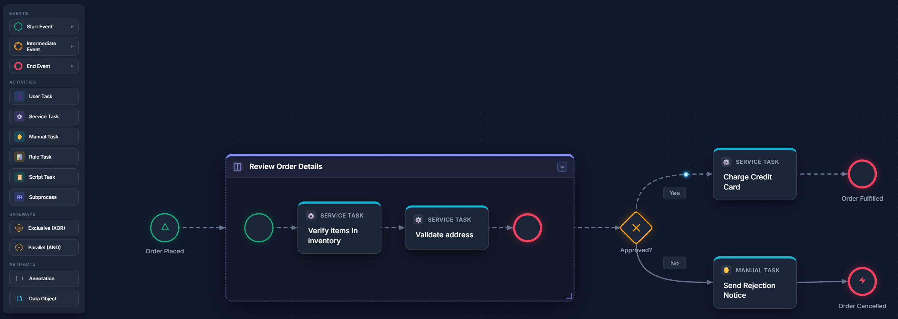
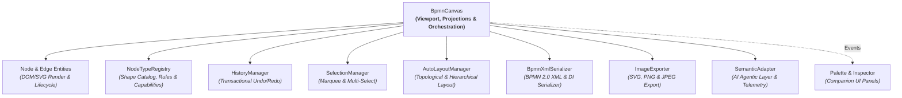

# BPMN Canvas

[](https://github.com/dphseven/bpmn-canvas/actions/workflows/ci.yml)
[](LICENSE)
[](https://www.npmjs.com/package/bpmn-canvas)
[](https://codecov.io/gh/dphseven/bpmn-canvas)
[](package.json)

> A lightweight, zero-dependency workflow canvas and diagram modeler inspired by BPMN 2.0, built with native DOM + SVG architecture.



## Key Features

- **Zero-Dependency Native DOM + SVG Architecture**  
  Built entirely on standard browser APIs with zero runtime dependencies. Nodes render as native HTML elements for crisp typography and instant CSS styling, while connectors render as scalable SVG vector paths with high-DPI clarity.

- **Dual-Mode Interoperability: BPMN 2.0 XML & Clean JSON**  
  Full bidirectional import/export for standard BPMN 2.0 XML with non-destructive Bezier curve preservation and BPMNDI waypoints, alongside clean, database-ready JSON.

- **Built for AI Agents (`SemanticAdapter`)**  
  Ingest declarative workflows without coordinates, stream debounced telemetry diffs tailored for LLMs, direct visual attention with highlights/focus, and lint BPMN semantics.

- **Zero-Dependency Auto-Arrange Layout Engine (`AutoLayoutManager`)**  
  Built-in hierarchical Sugiyama-style layout engine tailored for BPMN 2.0 workflows with boundary event docking, subprocess nesting, and automatic fit-view.

- **High-Fidelity Diagram Image Export (`ImageExporter`)**  
  Client-side diagram export to standalone vector SVG, high-resolution PNG, and JPEG with custom padding and theme background styling.

- **Extensible Plugin & Capability Architecture (`NodeTypeRegistry`)**  
  Fine-grained node capabilities, custom HTML/SVG renderers, dynamic port configurations, custom connection rules, and custom element factories.

- **Headless & Framework-Agnostic**  
  Embed the complete out-of-the-box studio or mount the headless canvas engine directly into React, Vue, Svelte, or vanilla JS apps.

---

## Feature Comparison

| Feature / Capability               |             `bpmn-canvas`             |            `bpmn-js`             |     `React Flow` / `xyflow`      |
| :--------------------------------- | :-----------------------------------: | :------------------------------: | :------------------------------: |
| **Runtime Dependencies**           |             **0 (Zero)**              |     Heavy (Diagram-js, etc.)     |       React / Svelte bound       |
| **Framework Agnostic**             |  ✅<br/>(Vanilla, React, Vue, Svelte)  |    ⚠️<br/>(DOM wrapper needed)    |    ❌<br/>(React/Svelte only)     |
| **BPMN 2.0 XML (Bidirectional)**   |     ✅<br/>Full (preserves Bezier)     |           ✅<br/>Native           |           ❌<br/>(DIY)            |
| **Clean JSON Serialization**       |           ✅<br/>Native JSON           |       ❌<br/>(XML-centric)        |         ✅<br/>Plain JSON         |
| **AI / Agentic Adapter**           |  ✅<br/>Built-in (`SemanticAdapter`)   |            ❌<br/>None            |           ❌<br/>(DIY)            |
| **Built-in Auto-Layout**           |       ✅<br/>Zero-dep DAG engine       | ⚠️<br/>(Requires external layout) | ⚠️<br/>(Requires external layout) |
| **Boundary Events & Subprocesses** |    ✅<br/>Automatic docking/nesting    |            ✅<br/>Yes             |  ❌<br/>(DIY manual positioning)  |
| **Client-Side Image Export**       |    ✅<br/>SVG, PNG, JPEG, XML, JSON    |  ⚠️<br/>XML/SVG (PNG via plugin)  |  ⚠️<br/>Manual via html-to-image  |
| **CSS Variable Theming**           | ✅<br/>Native light/dark design tokens |    ❌<br/>Canvas/inline heavy     |       ✅<br/>CSS Variables        |

---

## Installation

```bash
npm install bpmn-canvas
# or
pnpm add bpmn-canvas
# or
yarn add bpmn-canvas
```

Include the companion stylesheets in your application entry point:

```javascript
import 'bpmn-canvas/styles/ui.css';
import 'bpmn-canvas/styles/canvas.css';
import 'bpmn-canvas/styles/nodes.css';
```

---

## Quick Start

### 1. HTML Container

Provide a styled container element where the canvas can mount:

```html
<div id="canvas-container" style="width: 100vw; height: 100vh;"></div>
```

### 2. Instantiate and Build a Workflow

```javascript
import { BpmnCanvas } from 'bpmn-canvas';

// Mount canvas to the DOM container
const container = document.getElementById('canvas-container');
const canvas = new BpmnCanvas(container, {
  snapToGrid: true,
  gridSize: 24,
  defaultRouting: 'bezier' // or 'orthogonal'
});

// Add BPMN workflow nodes
const start = canvas.addNode({
  type: 'start-event',
  x: 100,
  y: 150,
  label: 'Order Placed'
});

const task = canvas.addNode({
  type: 'user-task',
  x: 260,
  y: 130,
  label: 'Review Order'
});

const end = canvas.addNode({
  type: 'end-event',
  x: 480,
  y: 150,
  label: 'Order Fulfilled'
});

// Connect with sequence flows
canvas.addEdge({ sourceId: start.id, targetId: task.id });
canvas.addEdge({ sourceId: task.id, targetId: end.id });
```

---

## Core Concepts & Architecture

`bpmn-canvas` separates visual modeling concerns into focused, decoupled subsystems:



- **`BpmnCanvas`**: Core viewport engine. Manages DOM container lifecycle, zoom/pan transforms, coordinate mapping (`clientToCanvas`), connector rendering, and user capabilities (e.g. `readOnly`, `allowDrag`).
- **`Node` & `Edge` Entities**: Stateful graph primitives. Nodes manage DOM element rendering, port anchors, and boundary docking; Edges manage SVG path calculation, routing strategies (Bezier/orthogonal), and animated token simulation.
- **`AutoLayoutManager`**: Zero-dependency layout engine. Implements hierarchical DAG layout for BPMN workflows with boundary event preservation and container nesting.
- **`BpmnXmlSerializer`**: Full BPMN 2.0 XML bidirectional parser and serializer with diagram interchange (BPMNDI) and bezier curve preservation.
- **`ImageExporter`**: Client-side diagram export engine generating vector SVG, high-DPI PNG, or JPEG images.
- **`SemanticAdapter`**: Agentic collaboration bridge translating visual canvas states into compact semantic graphs, telemetry streams, and linter diagnostics for AI agents.
- **`NodeTypeRegistry`**: Extensible element type catalog defining categories, icons, default dimensions, capabilities, custom renderers, and connection rules.
- **`HistoryManager`**: Transactional undo/redo engine capturing debounced property modifications and atomic compound operations executed via `canvas.batch()`.
- **`SelectionManager`**: Encapsulates single-selection, multi-select modifier clicks, and background marquee box sweeps.
- **`Palette` & `Inspector`**: Standalone companion UI panels communicating with the canvas via standard event bus subscriptions.

---

## Feature Guides & Recipes

### 1. Auto-Arrange Layout Engine

Reorganize any diagram into a clean, hierarchical DAG with a single call:

```javascript
// Auto-layout with default horizontal orientation and auto-fit
canvas.autoArrange();

// Customize layout options
canvas.autoArrange({
  direction: 'LR',       // 'LR' (Left-to-Right) or 'TB' (Top-to-Bottom)
  horizontalGap: 120,    // Horizontal spacing between rank columns (px)
  verticalGap: 80,       // Vertical spacing between parallel rows (px)
  startX: 80,            // Starting X offset
  startY: 120,           // Starting Y offset
  fitView: true          // Automatically zoom-to-fit after layout
});
```

### 2. BPMN 2.0 XML & JSON Serialization

Seamlessly interchange workflows with enterprise BPMN suites (Camunda, bpmn-js, Signavio) or persist directly as lightweight JSON:

```javascript
// Export standard BPMN 2.0 XML (preserves Bezier curves and BPMNDI layout)
const xmlString = canvas.exportToBpmnXml();

// Import standard BPMN 2.0 XML
canvas.importFromBpmnXml(xmlString, { autoFit: true });

// Export lightweight JSON (ideal for databases or REST APIs)
const jsonPayload = canvas.exportToJson();

// Import lightweight JSON
canvas.importFromJson(jsonPayload);
```

### 3. Diagram Image Export (SVG, PNG, JPEG)

Render and download high-resolution diagram graphics directly in the browser:

```javascript
// Export as PNG Blob
const pngBlob = await canvas.exportImage('png', {
  padding: 40,
  background: '#18181b', // or 'transparent'
  pixelRatio: 2          // High-DPI export
});

// Download helper
const url = URL.createObjectURL(pngBlob);
const link = document.createElement('a');
link.download = 'workflow.png';
link.href = url;
link.click();
URL.revokeObjectURL(url);

// Export as standalone vector SVG
const svgBlob = await canvas.exportImage('svg', { padding: 40 });

// Export as JPEG
const jpegBlob = await canvas.exportImage('jpeg', { quality: 0.95 });
```

### 4. AI-Agentic Integration (`SemanticAdapter`)

Build AI-powered workflow automation, copilots, or autonomous workflow agents:

```javascript
// 1. Ingest declarative workflow graphs without manual coordinates
canvas.applySemanticGraph({
  direction: 'LR',
  nodes: [
    { id: 'start', type: 'start-event', label: 'Invoice Received' },
    { id: 'ocr', type: 'service-task', label: 'Extract OCR Data' },
    { id: 'check', type: 'exclusive-gateway', label: 'Amount > $5k?' },
    { id: 'approval', type: 'user-task', label: 'Manager Approval' },
    { id: 'pay', type: 'service-task', label: 'Process Payment' },
    { id: 'end', type: 'end-event', label: 'Invoice Settled' }
  ],
  edges: [
    { source: 'start', target: 'ocr' },
    { source: 'ocr', target: 'check' },
    { source: 'check', target: 'approval', label: 'Yes' },
    { source: 'check', target: 'pay', label: 'No' },
    { source: 'approval', target: 'pay' },
    { source: 'pay', target: 'end' }
  ]
});

// 2. Extract token-efficient semantic snapshot for LLM context prompts
const snapshot = canvas.getSemanticSnapshot();

// 3. Subscribe to debounced semantic telemetry diffs
const unsubTelemetry = canvas.onSemanticTelemetry((diff) => {
  console.log('Semantic graph changes for agent context:', diff.summary);
  // diff.summary provides concise Markdown lines ideal for LLM prompts
});

// 4. Validate workflow with built-in BPMN 2.0 Semantic Linter
const report = canvas.validateWorkflow();
if (!report.valid) {
  console.warn('Workflow violations:', report.errors, report.warnings);
}

// 5. Direct visual attention
canvas.highlightNodes(['ocr'], { color: '#6366f1', badge: 'AI Processing' });
canvas.focusNode('ocr');
canvas.clearHighlights();

// 6. Graph reasoning and traversal
const upstream = canvas.getUpstreamNodes('pay');
const paths = canvas.findPaths('start', 'end');
const simResult = canvas.simulatePath({ startId: 'start' });
```

### 5. Custom Node Types & Extensibility

Extend the shape catalog with custom icons, badges, capabilities, custom renderers, and connection validation rules:

```javascript
import { NodeTypeRegistry, BpmnCanvas } from 'bpmn-canvas';

const registry = new NodeTypeRegistry();

// 1. Register custom element type with capabilities
registry.register('ai-agent-task', {
  label: 'AI Agent Task',
  category: 'activities',
  badge: 'AI Agent',
  icon: '🤖',
  width: 140,
  height: 80,
  capabilities: {
    allowIncoming: true,
    allowOutgoing: true,
    customPorts: ['top', 'bottom', 'left', 'right']
  }
});

// 2. Register custom SVG/DOM node renderer
registry.registerRenderer('ai-agent-task', (node, container) => {
  container.innerHTML = `
    <div class="custom-agent-node">
      <span class="agent-icon">🤖</span>
      <span class="agent-label">${node.label}</span>
    </div>
  `;
});

// 3. Register custom connection validation rules
registry.registerConnectionRule((sourceNode, targetNode, context) => {
  if (sourceNode.type === 'end-event') {
    return { valid: false, message: 'End events cannot have outgoing flows' };
  }
  return { valid: true };
});

// Mount canvas using the custom registry
const canvas = new BpmnCanvas(container, { registry });
```

---

## Framework Integration

Because `bpmn-canvas` mounts directly onto any standard DOM element, it drops seamlessly into modern component lifecycles:

### React

```jsx
import { useEffect, useRef } from 'react';
import { BpmnCanvas } from 'bpmn-canvas';
import 'bpmn-canvas/styles/canvas.css';
import 'bpmn-canvas/styles/nodes.css';

export function WorkflowCanvas() {
  const containerRef = useRef(null);
  const canvasRef = useRef(null);

  useEffect(() => {
    if (containerRef.current && !canvasRef.current) {
      canvasRef.current = new BpmnCanvas(containerRef.current, {
        snapToGrid: true
      });
    }
  }, []);

  return <div ref={containerRef} style={{ width: '100%', height: '100vh' }} />;
}
```

### Vue 3

```vue
<script setup>
import { ref, onMounted } from 'vue';
import { BpmnCanvas } from 'bpmn-canvas';
import 'bpmn-canvas/styles/canvas.css';
import 'bpmn-canvas/styles/nodes.css';

const containerRef = ref(null);
let canvas = null;

onMounted(() => {
  canvas = new BpmnCanvas(containerRef.value, {
    snapToGrid: true
  });
});
</script>

<template>
  <div ref="containerRef" style="width: 100%; height: 100vh;" />
</template>
```

### Svelte

```svelte
<script>
  import { onMount } from 'svelte';
  import { BpmnCanvas } from 'bpmn-canvas';
  import 'bpmn-canvas/styles/canvas.css';
  import 'bpmn-canvas/styles/nodes.css';

  let container;
  let canvas;

  onMount(() => {
    canvas = new BpmnCanvas(container);
  });
</script>

<div bind:this={container} style="width: 100%; height: 100vh;" />
```

---

## Event Catalog

The canvas provides a typed-like event bus with automatic unsubscribe functions:

```javascript
// Subscribe to any canvas event
const unsub = canvas.on('node:add', (node) => {
  console.log('Added node:', node.id, node.type);
});

// Clean up when component unmounts
unsub();
```

| Event Name              | Description                                              | Payload                                                                             |
| :---------------------- | :------------------------------------------------------- | :---------------------------------------------------------------------------------- |
| `node:add`              | Fired when a node is added                               | `BpmnNode`                                                                          |
| `node:remove`           | Fired when a node is removed                             | `nodeId`                                                                            |
| `node:update`           | Fired when node properties, label, or position change    | `BpmnNode`                                                                          |
| `node:labelChange`      | Fired when node label text is committed                  | `{ node, label }`                                                                   |
| `edge:add`              | Fired when an edge is added                              | `BpmnEdge`                                                                          |
| `edge:remove`           | Fired when an edge is removed                            | `edgeId`                                                                            |
| `edge:update`           | Fired when edge properties or routing change             | `BpmnEdge`                                                                          |
| `edge:reconnect`        | Fired when an edge is reconnected to new endpoints       | `{ edge, updates }`                                                                 |
| `edge:split`            | Fired when an edge is split by a dropped node            | `{ edgeId, nodeId, edge1, edge2 }`                                                  |
| `selection:change`      | Fired when selection state changes                       | `{ type: 'node'\|'edge'\|'multi'\|'none', item?, items? }`                          |
| `palette:dragstart`     | Fired when user starts dragging an item from the palette | `{ type, element, grabOffsetX, grabOffsetY, event }`                                |
| `palette:drop`          | Fired when an item from the palette is dropped on canvas | `{ type, node, position, isBoundary, splitEdgeId?, parentId?, hostNodeId?, event }` |
| `palette:filterChange`  | Fired when palette filters are modified                  | `{ filter }`                                                                        |
| `palette:itemRegister`  | Fired when a custom item is registered on palette        | `{ category, itemDef }`                                                             |
| `history:change`        | Fired on undo/redo availability change                   | `{ canUndo, canRedo }`                                                              |
| `viewport:change`       | Fired on zoom or pan adjustments                         | `{ zoom, panX, panY }`                                                              |
| `batch:complete`        | Fired when an atomic batch operation completes           | `{ preBatchState, postBatchState }`                                                 |
| `canvas:autoarrange`    | Fired when auto-layout is executed                       | `{ options, changed }`                                                              |
| `canvas:export`         | Fired when diagram image export completes                | `{ format, size, options }`                                                         |
| `connection:rejected`   | Fired when a connection rule rejects an edge             | `{ sourceId, targetId, reason }`                                                    |
| `theme:change`          | Fired when canvas color theme is toggled                 | `{ themeClass }`                                                                    |
| `data:load`             | Fired when a new diagram data payload is loaded          | `data`                                                                              |
| `simulation:start/stop` | Fired when token simulation begins or ends               | `void`                                                                              |

---

## Programmatic API Overview

```javascript
import { BpmnCanvas } from 'bpmn-canvas';

const canvas = new BpmnCanvas(document.getElementById('canvas-container'));

// Transactional Batch Execution (Single Undo Step)
canvas.batch(() => {
  const start = canvas.addNode({ type: 'start-event', x: 100, y: 150 });
  const task = canvas.addNode({ type: 'user-task', x: 260, y: 135, label: 'Review Order' });
  canvas.addEdge({ sourceId: start.id, targetId: task.id });
});

// Granular Graph Queries & Updates
const node = canvas.getNode('some-node-id');
canvas.updateNode('some-node-id', { label: 'Updated Label', x: 300 });
canvas.updateEdge('some-edge-id', { animated: true });
canvas.removeNode('some-node-id');
canvas.removeEdge('some-edge-id');

// Viewport Controls
canvas.fitView();
canvas.centerNode('some-node-id');
canvas.setZoom(1.2);
canvas.panTo(0, 0);

// Layout & Interoperability
canvas.autoArrange({ direction: 'LR', fitView: true });
const xml = canvas.exportToBpmnXml();
canvas.importFromBpmnXml(xml);
const blob = await canvas.exportImage('png');
```

---

## Keyboard Shortcuts & Controls

| Shortcut / Gesture                              | Action                                          |
| :---------------------------------------------- | :---------------------------------------------- |
| **Click + Drag (Node)**                         | Move selected node(s) with snap-to-grid         |
| **Space + Click Drag** or **Middle-Click Drag** | Pan canvas viewport                             |
| **Mouse Wheel**                                 | Zoom in / Zoom out centered on cursor position  |
| **Click + Drag (Canvas Background)**            | Draw rectangular marquee multi-selection box    |
| **Shift + Click**                               | Add / remove node from multi-selection          |
| **Double Click (Node / Edge)**                  | Enter inline label editing mode                 |
| **Delete** / **Backspace**                      | Delete currently selected node(s) or edge       |
| **Ctrl + Z** / **Cmd + Z**                      | Undo previous canvas action                     |
| **Ctrl + Y** / **Cmd + Shift + Z**              | Redo previous undone canvas action              |
| **Ctrl + A** / **Cmd + A**                      | Select all nodes and edges                      |
| **Escape**                                      | Clear active selection or dismiss inline editor |

---

## Package Exports

The `bpmn-canvas` package exports the following modules and primitives:

```javascript
import {
  BpmnCanvas,               // Main canvas viewport orchestrator
  BpmnNode,                 // Node entity
  BpmnEdge,                 // Edge entity
  Router,                   // Bezier and orthogonal Manhattan edge router
  Palette,                  // Drag-and-drop element palette component
  Inspector,                // Property inspector side panel
  NodeTypeRegistry,         // Extensible shape catalog, rules, and capabilities
  HistoryManager,           // Transactional undo/redo engine
  SelectionManager,         // Single and multi-element selection manager
  AutoLayoutManager,        // Zero-dependency hierarchical layout engine
  BpmnXmlSerializer,        // BPMN 2.0 XML bidirectional parser and serializer
  BPMN_NAMESPACES,          // Standard BPMN 2.0 XML schema namespace URIs
  ImageExporter,            // SVG, PNG, and JPEG export engine (via canvas.exportImage)
  SemanticAdapter,          // AI-Agentic collaboration, telemetry, and linter layer
  SimulationEngine,         // Token animation and path execution simulator
  SubprocessLayoutManager,  // Container expansion and child displacement engine
  NodeRenderer,             // DOM node element renderer
  InlineEditor,             // Double-click inline typography editor
  geometry,                 // Coordinate transformations and vector math utilities
  types                     // TypeScript-style interface and contract definitions
} from 'bpmn-canvas';
```

---

## Contributing

We welcome contributions, bug reports, and enhancements!

### Local Development Setup

```bash
# Clone the repository
git clone https://github.com/dphseven/bpmn-canvas.git
cd bpmn-canvas

# Install dependencies
npm install

# Run the test suite
npm test

# Run tests in watch mode
npm run test:watch

# Check test coverage (enforcing >= 80% coverage)
npm run coverage
```

### License
This project is licensed under the [Apache License, Version 2.0](LICENSE).

### Acknowledgements
- **[OMG (Object Management Group)](https://www.omg.org/bpmn/)**: For the BPMN 2.0 (Business Process Model and Notation) standard and visual specification that guides the shapes, semantics, and connection rules in this library.
- **[bpmn.io / bpmn-js (Camunda)](https://bpmn.io/)**: For pioneering modern, open-source web-based BPMN modeling and setting the benchmark for browser diagramming ergonomics.
- **Modern Canvas & Node Graph Pioneers**: Architectural patterns and interaction models inspired by modern visual node graphs such as [React Flow / xyflow](https://reactflow.dev/) and [LiteGraph](https://github.com/jagenjo/litegraph.js).
- **Google Fonts**: For the clean UI typography powered by [Inter](https://fonts.google.com/specimen/Inter).
